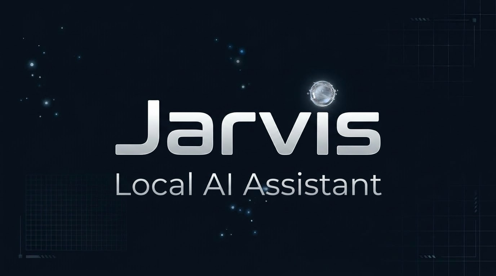
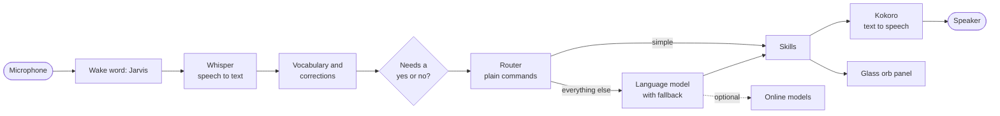

<p align="center">
  
</p>

<h1 align="center">Jarvis</h1>

<p align="center">
  A voice assistant that lives on your PC. It listens for its name, runs your apps and browser, reads your screen and
  email, and helps you code. The language model runs <b>locally</b> in LM Studio, and online models are strictly optional.
</p>

<p align="center">
  
  
  
</p>

<p align="center">
  
</p>

---

## Why Jarvis

- **Private by default.** Your voice is turned into text on your PC, and the language model runs on your PC. Nothing
  leaves it unless you add an online model yourself and allow it.
- **Adapts to your models.** It uses whatever is loaded in LM Studio. A fast model handles conversation, a coder model
  handles code, a vision model handles pictures, and each can have backups, local or online.
- **Careful with risky things.** Shutting down, sending email and closing programs with unsaved work all ask first.
- **Learns how you speak.** Mispronounced app names, project names and songs get fixed the second time.
- **Nothing to edit.** Email, models and online providers are set up in windows, or by voice. No code or config files.

## What it can do

| Area                                     | Examples                                                                                                           |
| ---------------------------------------- | ------------------------------------------------------------------------------------------------------------------ |
| **Apps and projects**                    | open or close any app, open a coding project in your editor                                                        |
| **Browser** (Chrome extension)           | play a song on YouTube, skip ads, skip ahead, close or refresh tabs by name, read or summarize the page you are on |
| **Music**                                | Spotify and any media player: play, pause, next, previous                                                          |
| **PC control**                           | volume, brightness, lock, screenshot, battery, memory, disk, shutdown and restart (with confirmation)              |
| **Reminders and notes**                  | reminders, alarms that ring until you dismiss them, notes you can search                                           |
| **Screen reading**                       | "what's on my screen?", "read this message", using a vision model or OCR                                           |
| **Email** (Gmail, Yahoo, iCloud, others) | check new mail by category, read, reply, draft, save drafts, send after you say _confirm_                          |
| **Coding help**                          | write, explain and fix code with a coder model; the code lands on your clipboard                                   |
| **Developer status**                     | CPU load, running Docker containers, a project's git status                                                        |
| **Clipboard**                            | explain, summarize, translate or fix whatever you copied                                                           |

## How it works



Simple commands such as "open Discord" or "pause the music" skip the model entirely. They are faster, and they can't be
answered with words instead of an action. Everything else goes to the model, which picks a tool.

## Requirements

- **Windows 10 or 11** (it uses Windows audio, PowerShell and the Windows API)
- **Python 3.10 or newer**
- **[LM Studio](https://lmstudio.ai/)** with at least one model that supports **tool use**, for example a Qwen 2.5
  Instruct model
- **A microphone** (or your PC's soundboard)
- **[Node.js](https://nodejs.org/) 18 or newer** for the glass orb. Optional: without it, a simpler panel is used.
- **Google Chrome** (or another Chromium browser) for the browser features. Optional.

## Install

**1. Get the code and set up Python**

```bat
git clone https://github.com/Siegenetics404/Jarvis.git
cd jarvis
python -m venv .venv
.venv\Scripts\activate
pip install -r requirements.txt
```

**2. Download the voice model** into the project folder

```bat
curl -L -O https://github.com/thewh1teagle/kokoro-onnx/releases/download/model-files-v1.0/kokoro-v1.0.onnx
curl -L -O https://github.com/thewh1teagle/kokoro-onnx/releases/download/model-files-v1.0/voices-v1.0.bin
```

The speech recognition model (Whisper) downloads itself the first time you run Jarvis. It is a few hundred MB, so the
first start takes a minute.

**3. Optional extras**

```bat
pip install -r requirements-optional.txt
```

| Package                | What it adds                                                                    |
| ---------------------- | ------------------------------------------------------------------------------- |
| `pillow`               | screen reading                                                                  |
| `rapidocr-onnxruntime` | reads the text on your screen when your model can't see images                  |
| `keyring`              | keeps email passwords and API keys in Windows' password store instead of a file |

**4. The glass orb** (optional)

```bat
cd body-ui
npm install
cd ..
```

**5. The Chrome extension** (optional, for the browser features)

1. Open `chrome://extensions` and turn on **Developer mode**.
2. Click **Load unpacked** and choose the `extension` folder.
3. When Chrome asks, approve the permissions. The extension talks only to Jarvis on your own PC (`127.0.0.1`).

**6. Start LM Studio**

Load a tool-capable model, open the **Developer** tab and **start the server**. No model name is needed anywhere;
Jarvis uses what is loaded.

**7. Run it**

```bat
python jarvis.py
```

Say **"Jarvis, hello"**.

## First-time setup (all by voice or in windows)

| Say                              | What happens                                                                     |
| -------------------------------- | -------------------------------------------------------------------------------- |
| _"Jarvis, set up my email"_      | a window opens: provider, address, app password, **Test**, contacts              |
| _"Jarvis, change the model"_     | the model window: see, load and test your LM Studio models                       |
| _"Jarvis, add an online model"_  | Gemini, Claude, OpenAI and others, with a key, a daily limit and privacy choices |
| _Right-click the orb → Settings_ | transparency, size, colour, position, behaviour                                  |

The one setting that is still a file: the folders where your coding projects live (`PROJECT_ROOTS` in `actions.py`).

## Things you can say

Start with **"Jarvis"**. For a few seconds afterwards you can keep talking without repeating it. Say **"stop"** (or
double-click the orb) to cut him off.

<details>
<summary><b>Apps, browser and PC</b></summary>

- "Open Discord", "close Spotify", "open the _portfolio_ project"
- "Play _Cup of Joe_ on YouTube", "skip the ad", "skip ahead 30 seconds", "next video"
- "Close the YouTube tab", "how many tabs are open?", "refresh this tab", "refresh GitHub"
- "Pause the music", "next song", "play the music in Spotify"
- "Turn the volume up", "set the brightness to 40", "lock the screen", "take a screenshot"
- "How's my battery?", "what's my CPU load?", "which Docker containers are running?"
- "Shut down the computer" (he asks you to say _confirm_)
- "Close it" or "undo that": closes whatever he just opened

</details>

<details>
<summary><b>Reading and screen</b></summary>

- "What's on my screen?", "what am I looking at?"
- "Read the last message" (the chat or page you have open)
- "Summarize this page", "read what I selected"
- "Explain this error" (reads your clipboard)

</details>

<details>
<summary><b>Email</b></summary>

- "Do I have new emails?", "check my promotions", "how many unread emails in each category?"
- "Read the first one", "read the email from Maria", "reply saying yes, Friday works"
- "Email Maria that I'll be late and ask to move it to 3 PM", then "make it shorter", "save it as a draft", "send it", **"confirm"**
- "How many spam do I have?", "what's in my drafts?", "what did I send to Maria?"
- "Save the sender as a contact", "who are my contacts?", "is my email connected?"

</details>

<details>
<summary><b>Coding</b></summary>

- "Write a Python function that reverses a string": the explanation is spoken, the code goes to your clipboard
- "Explain this code", "fix the bug in my code" (uses what you copied)
- "How do I validate an email in Laravel?"

</details>

<details>
<summary><b>Reminders and notes</b></summary>

- "Remind me in 10 minutes to stretch"
- "I'm taking a nap for 20 minutes": sets an alarm that keeps ringing until you dismiss it
- "Take a note: ...", "what did I note about ...?"

</details>

<details>
<summary><b>Models and privacy</b></summary>

- "Which models are you using?", "change the model", "load a model"
- "Go offline" / "stay local": switches off every online model
- "Go online"

</details>

## Models, fallback and online providers

Jarvis gives each kind of work its own model, chosen automatically from what is loaded in LM Studio:

| Role             | Used for                   | Best model                                                           |
| ---------------- | -------------------------- | -------------------------------------------------------------------- |
| **Conversation** | talking and choosing tools | a fast instruct model with tool use                                  |
| **Coding**       | code questions             | a coder model (found by name: _coder_, _codestral_, _devstral_, ...) |
| **Vision**       | looking at pictures        | a vision model                                                       |

If one fails (not loaded, too slow, empty answer), the next one in the list answers, and a model that just failed is
skipped for a minute. With only one model loaded, everything still works.

**Online models** (Gemini, Claude, OpenAI, OpenRouter, Groq, Mistral, DeepSeek, or any OpenAI-compatible service) can
join those lists as a **backup** or a **first choice**, per role. Each has a **daily request limit**, so a free plan is
not used up and a paid one can't surprise you. Keys go to Windows' password store (or `.env`), never to a settings file.

**What may go online** is up to you, one checkbox each:

| Data                                | Default                         |
| ----------------------------------- | ------------------------------- |
| Conversation (what you say to him)  | allowed once you add a provider |
| Coding requests and code you copied | allowed once you add a provider |
| **Email**                           | **off**                         |
| **Screen pictures and text**        | **off**                         |
| **Web page text**                   | **off**                         |

"Go offline" turns all online models off at once. The terminal prints a line every time a request goes online.

## Safety

- **Confirmation for risky actions.** Shutdown, restart, sleep and sending email need the word **"confirm"**; a bare
  "yes" is not enough, so a TV can't switch your PC off. Closing programs that may hold unsaved work asks too.
  Shutdown waits 20 seconds, and "stop" cancels it.
- **Doubt means asking.** If speech recognition isn't sure it heard you, he asks before closing an app or tabs.
- **Email goes only to your contacts**, or to someone who emailed you. He never sends to an address he merely heard.
- **Email text is untrusted.** It is only read or summarized by a model call that has no tools, so a hostile email
  can't make him do anything.
- **Read-only where it matters.** Reading mail never marks it as read, and he never deletes or moves mail.
- **Coding help only answers.** It never edits your files.

## Your data

Everything personal is kept in `data/` (and `.env`), and both are excluded from git:

| File                  | What it is                                                 |
| --------------------- | ---------------------------------------------------------- |
| `vocabulary.txt`      | names Whisper should spell right; he adds the apps you use |
| `corrections.txt`     | fixes for phrases he mishears, like `java is = Jarvis`     |
| `contacts.txt`        | people he may email                                        |
| `learned_names.json`  | app and project names he learned from you                  |
| `model_settings.json` | model roles, fallback, online providers (no keys)          |
| `orb_settings.json`   | the panel's look and position                              |
| `online_usage.json`   | requests per online provider per day                       |

Copy each `data/*.example.txt` to the same name without `.example` to start from a template. Jarvis also works
without them.

## Project layout

```
jarvis/
├── jarvis.py            the main program: listening, wake word, speaking
├── actions.py           built-in tools (apps, projects, websites, tabs) and the skill loader
├── router.py            commands handled without the model
├── safety.py            confirmation before risky actions
├── session_memory.py    short-term memory ("close it")
├── learning.py          learns the names you say
├── vocabulary.py        vocabulary.txt and automatic spelling fixes
├── jarvis_llm.py        models: LM Studio, roles, fallback
├── jarvis_cloud.py      online providers
├── model_setup.py       the model window
├── online_setup.py      the online models tab
├── email_config.py      email settings and contacts
├── email_setup.py       the email settings window
├── browser_bridge.py    talks to the Chrome extension
├── body_orb.py          the glass orb (Electron) body
├── body.py              the simple fallback panel
├── body-ui/             the orb (Electron app)
├── extension/           the Chrome extension
├── skills/              one file per ability
└── data/                your private settings (git-ignored)
```

## Add your own skill

A skill is one file in `skills/`. Jarvis loads every file there at startup.

```python
# skills/hello.py
from skills import tool

def say_hello(name=""):
    return f"Hello {name or 'there'}, sir."

HINT = "Greeting: use say_hello when the user asks you to say hello to someone."

SCHEMAS = [
    tool("say_hello", "Say hello to someone.", {"name": "Who to greet"}, optional=("name",)),
]
TOOLS = {"say_hello": say_hello}
```

- `SCHEMAS` describes the tool to the model, `TOOLS` maps its name to your function, and `HINT` tells the model when to
  use it. A tool returns the sentence Jarvis should say.
- For simple phrases that must never be misunderstood, add a rule to `router.py` so the model isn't involved.
- If your tool is risky, register it with `safety.py` so it asks first.

## Troubleshooting

| Problem                                    | Fix                                                                                 |
| ------------------------------------------ | ----------------------------------------------------------------------------------- |
| _"I can't reach LM Studio"_                | open LM Studio, **Developer** tab, start the server                                 |
| _"No model is loaded"_                     | load a model in LM Studio, or say "change the model"                                |
| He talks about an action but doesn't do it | your model may not support tools; open the model window and press **Test**          |
| _"My browser extension is out of date"_    | reload the extension at `chrome://extensions` after updating the project            |
| _"I can't reach your browser"_             | the extension is off, or Chrome isn't open                                          |
| The orb doesn't appear                     | run `npm install` in `body-ui`; see `data/body-ui.log`                              |
| The orb is off screen                      | press **Ctrl+Alt+J** to bring it back                                               |
| He mishears a name                         | add it to `data/vocabulary.txt`, or `data/corrections.txt`                          |
| Email login fails                          | use an **app password** (Gmail needs 2-Step Verification), not your normal password |
| A model is too slow                        | use a smaller one, or set `WHISPER_MODEL = "base.en"` in `jarvis.py`                |

## Roadmap

- Speaker recognition, so only your voice gives commands
- A coding assistant that works inside a project folder
- A "new tab" command
- Linux and macOS support

## Contributing

Issues and pull requests are welcome. Please keep the **local-first** rule: anything that sends data to an online
service must be off by default and clearly shown to the user.

## License

<!-- Choose a license, add a LICENSE file, and update this line. -->

MIT. See [LICENSE](LICENSE).

## Thanks

[faster-whisper](https://github.com/SYSTRAN/faster-whisper),
[Kokoro](https://github.com/thewh1teagle/kokoro-onnx), [LM Studio](https://lmstudio.ai/),
[Electron](https://www.electronjs.org/), and [yt-dlp](https://github.com/yt-dlp/yt-dlp).
